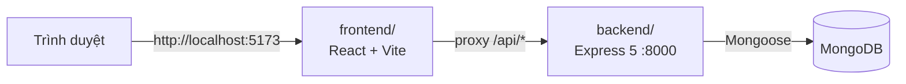
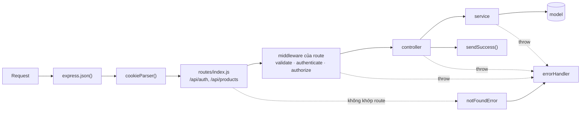

# 02 — Kiến trúc

Dùng khi cần hiểu các phần nối với nhau thế nào và "muốn làm X thì sửa ở đâu". Trước: [01 — Chạy local](01-chay-local.md) · Tiếp: [03 — Quy ước code](03-quy-uoc-code.md)

## Thành phần



| Thư mục | Vai trò | Công nghệ chính |
| --- | --- | --- |
| `backend/` | REST API dưới `/api` | Express 5, Mongoose 9, zod 4, jsonwebtoken, bcryptjs, pino |
| `frontend/` | Giao diện | React 19, Vite 8, oxlint |
| `docs/` | Tài liệu dev | Markdown + Mermaid |
| `scripts/` | Script dùng chung cho mọi workspace | Node.js thuần |

Monorepo dùng **npm workspaces** ([ADR-001](07-quyet-dinh/ADR-001-monorepo-npm-workspaces.md)).

**Ràng buộc**: trình duyệt chỉ gọi API qua đường dẫn tương đối `/api/...`. Lý do: cookie auth là httpOnly, `SameSite=Lax`. Gọi cùng origin (qua proxy Vite ở dev) thì cookie tự gửi kèm và không cần cấu hình CORS (backend hiện **không** bật CORS).

## Luồng một request trong backend



- Express 5 tự chuyển lỗi của handler `async` vào `errorHandler`, nên controller / service chỉ cần `throw`. Không cần `try/catch` hay `asyncHandler`.
- `errorHandler` (`backend/src/shared/middlewares/errorHandler.js`) chuẩn hoá mọi lỗi về cùng một format ([03 — Quy ước code](03-quy-uoc-code.md#lỗi-và-response)).
- Thứ tự gắn middleware nằm ở `backend/index.js`: `express.json` → `cookieParser` → `/api` routes → `notFoundError` → `errorHandler`.

## Cấu trúc backend

```text
backend/
├── index.js                  # tạo app, gắn middleware, listen
└── src/
    ├── config/               # envConfig (đọc .env), connectDB, schemaOptions
    ├── routes/index.js       # gom route các module dưới /api
    ├── modules/<tên>/        # mỗi nghiệp vụ một thư mục
    │   ├── <tên>.route.js    #   khai báo endpoint + middleware
    │   ├── <tên>.schema.js   #   zod schema validate input
    │   ├── <tên>.controller.js
    │   ├── <tên>.service.js  #   business logic
    │   └── <tên>.model.js    #   Mongoose model
    ├── seeds/                # npm run db:seed: index.js chạy lần lượt các *.seed.js
    └── shared/
        ├── constants/        # PERMISSIONS (danh mục), SYSTEM_ROLES…
        ├── errors/           # AppError, ERROR_CODES, httpErrors, notFoundError
        ├── middlewares/      # validate, authenticate, authorize, errorHandler
        ├── utils/            # jwt, hash, authCookies, accessControl, validators, duration, response
        ├── lib/lang/         # file ngôn ngữ en / vi (chưa dùng)
        └── logger.js         # pino
```

Các module hiện có: `auth`, `user` (gán role, khoá / mở khoá), `role` (CRUD role, danh mục permission), `session` (model + service, dùng bởi auth), `product`, `post` (chỉ model, chưa có route).

## Muốn làm X → sửa ở đâu

| Muốn | Sửa ở |
| --- | --- |
| Thêm endpoint cho module có sẵn | `<module>.route.js` + `<module>.controller.js` + `<module>.service.js`, input thêm vào `<module>.schema.js` |
| Thêm module mới | Tạo `backend/src/modules/<tên>/`, gắn route ở `backend/src/routes/index.js` ([quy ước](03-quy-uoc-code.md#module-mới)) |
| Bắt buộc đăng nhập / phân quyền cho route | Thêm `authenticate`, `authorize(PERMISSIONS.X)` vào route ([04 — Xác thực](04-xac-thuc.md#bảo-vệ-route)) |
| Thêm mã lỗi | `backend/src/shared/errors/errorCodes.js` |
| Thêm / đổi biến môi trường | `.env.example` của workspace → `npm run env:sync` → `envConfig.js` (BE) hoặc `vite.config.js` (FE) → bảng ở [01](01-chay-local.md#biến-môi-trường) |
| Đổi thời hạn token, cookie | Biến `JWT_*` · `backend/src/shared/utils/authCookies.js` |
| Thêm role / đổi permission của role | Không sửa code: gọi API `/api/roles` ([05](05-nguoi-dung.md#api)) |
| Thêm permission mới | `backend/src/shared/constants/permissions.js` + `authorize(...)` ở route ([05](05-nguoi-dung.md#bảo-vệ-route-bằng-permission)) |
| Đổi role hệ thống mặc định khi seed | `SYSTEM_ROLE_DEFAULTS` trong `backend/src/shared/constants/roles.js` (chỉ áp khi role chưa tồn tại) |
| Thêm dữ liệu seed | `backend/src/seeds/<tên>.seed.js` + mảng `SEEDERS` trong `backend/src/seeds/index.js` |
| Đổi cổng / proxy dev | `PORT` (BE), `API_PROXY_TARGET`, `FRONTEND_PORT` (FE) |
| Thêm script dùng chung cho BE + FE | `scripts/` + khai báo trong `package.json` gốc |
