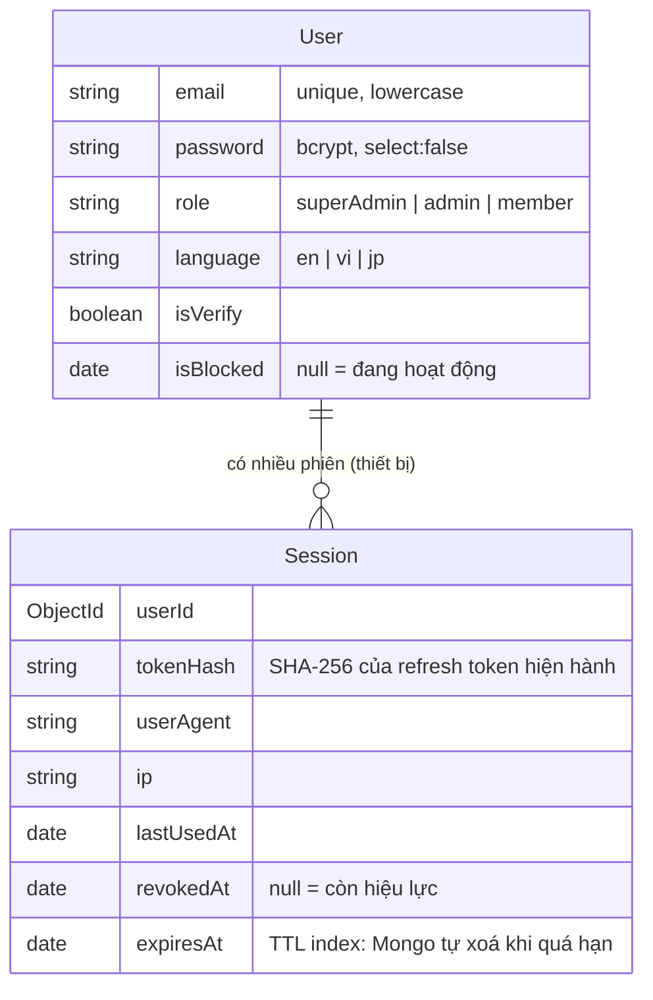
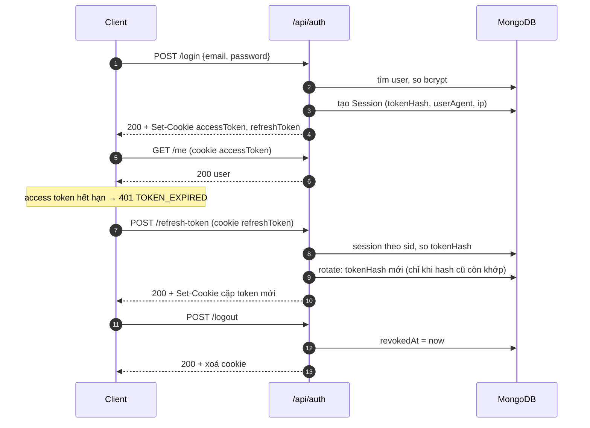

# 04 — Xác thực (auth)

Dùng khi làm việc với đăng ký, đăng nhập, token, cookie, phân quyền. Trước: [03 — Quy ước code](03-quy-uoc-code.md) · Tiếp: [05 — Sản phẩm](05-san-pham.md)

Code: `backend/src/modules/auth/`, `backend/src/modules/session/`, `backend/src/shared/middlewares/{authenticate,checkRole}.js`, `backend/src/shared/utils/{jwt,hash,authCookies}.js`. Lý do chọn thiết kế: [ADR-002](06-quyet-dinh/ADR-002-cookie-auth-session-rotation.md).

## Mô hình dữ liệu



- **Access token** (JWT, `JWT_ACCESS_SECRET`): payload `{ sub: userId, role }`, hạn `JWT_ACCESS_EXPIRES_IN` (mặc định 15m). Không lưu DB.
- **Refresh token** (JWT, `JWT_REFRESH_SECRET`): payload `{ sub: userId, sid: sessionId, jti }`, hạn `JWT_REFRESH_EXPIRES_IN` (mặc định 7d). DB chỉ lưu hash.
- Mỗi lần đăng nhập tạo **1 Session**, tương ứng một thiết bị. Mỗi lần refresh, `tokenHash` đổi, `_id` session giữ nguyên.

## Cookie

| Cookie | Path | Thời hạn | Cờ |
| --- | --- | --- | --- |
| `accessToken` | `/` | = `JWT_ACCESS_EXPIRES_IN` | `HttpOnly`, `SameSite=Lax`, `Secure` khi `NODE_ENV=production` |
| `refreshToken` | `/api/auth` | = `JWT_REFRESH_EXPIRES_IN` | như trên |

Refresh token chỉ được trình duyệt gửi tới `/api/auth/*`, không đi kèm mọi request. Token **không** trả trong body response.

## Luồng



**Phát hiện dùng lại token**: refresh token có chữ ký hợp lệ nhưng hash không khớp `tokenHash` hiện hành nghĩa là token cũ đã bị dùng lại (có thể bị đánh cắp). Khi đó server thu hồi cả session, trả `401 TOKEN_REUSED`, người dùng phải đăng nhập lại.

Gợi ý phía client: gặp `401 TOKEN_EXPIRED` thì gọi `POST /api/auth/refresh-token` rồi gửi lại request. Refresh thất bại thì chuyển sang trang đăng nhập.

## API

Base: `/api/auth`. Body JSON. Format response và lỗi chung: [03 — Lỗi và response](03-quy-uoc-code.md#lỗi-và-response).

| Method · Path | Middleware | Input | Thành công | Lỗi riêng |
| --- | --- | --- | --- | --- |
| `POST /register` | `validate(body)` | `{ email, password }` | `201`, `data` = user | `409 EMAIL_ALREADY_EXISTS` |
| `POST /login` | `validate(body)` | `{ email, password }` | `200`, `data` = user, set 2 cookie | `401 INVALID_CREDENTIALS`, `403 ACCOUNT_BLOCKED` |
| `POST /refresh-token` | `validate(cookies)` | cookie `refreshToken` | `200`, set cặp cookie mới | `400` thiếu / sai định dạng cookie, `401 TOKEN_EXPIRED` / `TOKEN_INVALID` / `TOKEN_REUSED`, `403 ACCOUNT_BLOCKED` |
| `POST /logout` | — | cookie `refreshToken` (không bắt buộc) | `200`, xoá 2 cookie | — (idempotent) |
| `GET /me` | `authenticate` | cookie `accessToken` hoặc `Authorization: Bearer` | `200`, `data` = user | `401`, `403 ACCOUNT_BLOCKED` |

`data` user: `{ id, email, role, language, isVerify, createdAt }`.

Rule validate (`auth.schema.js`):

| Field | Register | Login |
| --- | --- | --- |
| `email` | trim, lowercase, email hợp lệ, ≤ 254 ký tự | như register |
| `password` | 6–64 ký tự, ≥ 1 chữ cái, ≥ 1 chữ số, không khoảng trắng | bắt buộc, ≤ 64 ký tự (không áp rule độ mạnh) |
| field khác | từ chối (`.strict()`) | từ chối |

Thử nhanh bằng curl:

```bash
curl -i -c jar -H "Content-Type: application/json" \
  -d '{"email":"a@test.com","password":"abc123"}' http://localhost:8000/api/auth/login
curl -i -b jar http://localhost:8000/api/auth/me                  # → 200
curl -i -X POST -b jar -c jar http://localhost:8000/api/auth/refresh-token
curl -i -X POST -b jar -c jar http://localhost:8000/api/auth/logout
```

## Bảo vệ route

```js
import { authenticate } from "../../shared/middlewares/authenticate.js";
import { checkRole, ROLES } from "../../shared/middlewares/checkRole.js";

router.post("/", authenticate, checkRole(ROLES.ADMIN, ROLES.SUPER_ADMIN), validate({ body: schema }), controller.createOne);
```

- `authenticate`: đọc token từ cookie `accessToken` trước, không có thì đọc header `Authorization: Bearer <token>` (Postman, mobile). Sau khi verify, truy vấn DB lấy `role` và `isBlocked` mới nhất, rồi gắn `req.user = { id, email, role }`.
- `checkRole(...roles)`: luôn đặt **sau** `authenticate`. Không có `req.user` → `401`. Role không nằm trong danh sách → `403 FORBIDDEN`.
- Đổi role hoặc khoá user có hiệu lực ngay ở request tiếp theo, vì `authenticate` đọc từ DB chứ không đọc role trong token.

## Edge case & giới hạn

- Sai email và sai mật khẩu trả **cùng** thông báo, để không lộ email nào đã đăng ký.
- Hai request refresh song song với cùng token: chỉ một cái thành công. `rotate` có điều kiện hash cũ, cái còn lại nhận `401 TOKEN_INVALID`. Client nên gom refresh về một request duy nhất.
- User bị khoá: đăng nhập trả `403`, refresh thu hồi session và trả `403`.
- Session hết hạn bị MongoDB xoá tự động (TTL index trên `expiresAt`; Mongo quét khoảng 60 giây một lần).
- **Chưa có**: giới hạn số lần đăng nhập sai (rate limit), xác thực email, quên / đặt lại mật khẩu (`forgotPassword`, `resetPassword` là stub chưa gắn route), API danh sách thiết bị / đăng xuất thiết bị khác (đã có TODO trong `session.service.js`).
- Chưa có test tự động. Các luồng trên đã kiểm tra thủ công bằng curl ngày 2026-11-01.
