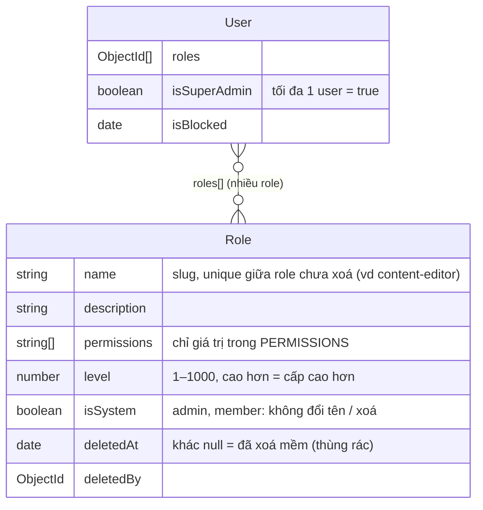
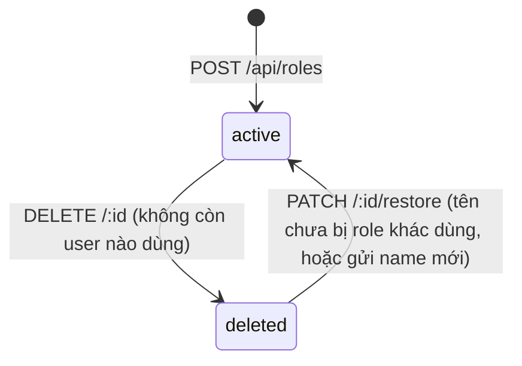

# 05 — Người dùng & phân quyền

Dùng khi làm việc với role, permission, gán role cho user, khoá / mở khoá tài khoản, hoặc chạy seed. Trước: [04 — Xác thực](04-xac-thuc.md) · Tiếp: [06 — Sản phẩm](06-san-pham.md)

Code:
- `backend/src/modules/role/`, `backend/src/modules/user/`
- `backend/src/shared/constants/{permissions,roles}.js`
- `backend/src/shared/utils/accessControl.js`, `backend/src/shared/middlewares/authorize.js`
- `backend/src/seeds/`

Lý do thiết kế: [ADR-004](07-quyet-dinh/ADR-004-phan-quyen-dong-rbac.md). ADR-004 thay [ADR-003](07-quyet-dinh/ADR-003-phan-quyen-role-va-superadmin-duy-nhat.md).

## Mô hình



| Khái niệm | Ở đâu | Đổi được qua API? |
| --- | --- | --- |
| **Permission** | Danh mục cố định trong `backend/src/shared/constants/permissions.js` | Không. Thêm permission là sửa code |
| **Role** | Collection `roles` | Có: CRUD, thêm / bớt permission, đổi level |
| **Role của user** | `User.roles[]` | Có: `PUT /api/users/:id/roles` |
| **superAdmin** | Cờ `User.isSuperAdmin` | Không. Chỉ tạo bằng seed |

- **Quyền thực tế** của user = hợp permission của mọi role họ có.
- **Cấp (level)** của user = `level` cao nhất trong các role của họ; không có role thì cấp 0.
- superAdmin bỏ qua mọi kiểm tra permission, có cấp vô hạn, và không ai tác động lên được.
- `authenticate` đọc role từ DB ở mỗi request. Vì vậy đổi permission của role, gán / gỡ role, hay khoá user đều **có hiệu lực ngay ở request tiếp theo**.

Permission hiện có:

| Permission | Cho phép |
| --- | --- |
| `user:block` | Khoá / mở khoá người dùng |
| `user:assign-role` | Gán role cho người dùng |
| `role:read` | Xem role và danh mục permission |
| `role:create` | Tạo role |
| `role:update` | Sửa role, thêm / bớt permission |
| `role:delete` | Xoá mềm và khôi phục role |

Role hệ thống (tạo bởi `npm run db:seed`):

| Role | Level | Permission ban đầu |
| --- | --- | --- |
| `admin` | 50 | Toàn bộ permission ở bảng trên |
| `member` | 1 | Không có. Role mặc định khi đăng ký |

Permission của role hệ thống chỉnh được qua API sau khi seed. Seed không ghi đè lại.

## Luật chống leo thang đặc quyền

Áp cho mọi thao tác. Kiểm tra nằm ở `accessControl.js`, `role.service.js`, `user.service.js`.

1. **Không tự tác động lên chính mình**, gồm gán role, khoá, mở khoá → `403 CANNOT_MODIFY_SELF`.
2. **Chỉ tác động lên user cấp thấp hơn hẳn** (cùng cấp cũng không được) → `403 TARGET_ROLE_NOT_ALLOWED`.
3. **Chỉ tạo / sửa / xoá / gán role có level thấp hơn hẳn cấp của mình.** Không được đặt level mới ≥ cấp của mình → `403 ROLE_LEVEL_NOT_ALLOWED`.
4. **Chỉ cấp permission mà mình đang có** → `403 PERMISSION_NOT_GRANTABLE`. Luật này áp cho:
   - permission khi tạo role;
   - permission **thêm mới** khi sửa role (bớt permission thì luôn được, kể cả permission mình không có);
   - permission của các role **mới gán thêm** cho user.
5. Role hệ thống không đổi tên được, không xoá được → `403 SYSTEM_ROLE_PROTECTED`.
6. Role đang được gán cho user thì không xoá được → `409 ROLE_IN_USE`. Phải gỡ role khỏi các user đó trước.
7. Khôi phục role cũng theo luật level (chỉ khôi phục role có level thấp hơn hẳn cấp của mình), và cần permission `role:delete`.

Ví dụ: admin (level 50) tạo role `editor` level 10 có `user:block`, rồi gán cho member. Người đó giờ có cấp 10: khoá được user cấp 1, nhưng không khoá được admin. Nếu superAdmin bỏ `role:delete` khỏi role admin, admin không cấp `role:delete` cho ai được nữa.

## API

Mọi route đều qua `authenticate` (chưa đăng nhập → `401`). Thiếu permission → `403 FORBIDDEN`. Format response và lỗi chung: [03 — Lỗi và response](03-quy-uoc-code.md#lỗi-và-response).

**Role** — `/api/roles`, `/api/permissions`:

| Method · Path | Permission | Input | Thành công |
| --- | --- | --- | --- |
| `GET /api/permissions` | `role:read` | — | `200`, `data` = `[{ key, group, description }]` |
| `GET /api/roles` | `role:read` | Query `?status=active` (mặc định) · `deleted` (thùng rác) · `all` | `200`, danh sách role (level giảm dần) kèm `userCount` |
| `GET /api/roles/:id` | `role:read` | — | `200`, role kèm `userCount`. Xem được cả role đã xoá mềm |
| `POST /api/roles` | `role:create` | `{ name, level, description?, permissions? }` | `201`, role |
| `PATCH /api/roles/:id` | `role:update` | Ít nhất 1 trong `name`, `description`, `level`, `permissions` | `200`, role |
| `DELETE /api/roles/:id` | `role:delete` | — | `200`, role (`deletedAt` khác null). **Xoá mềm**: chuyển vào thùng rác |
| `PATCH /api/roles/:id/restore` | `role:delete` | `{ name? }`: đổi tên khi khôi phục (tuỳ chọn) | `200`, role (`deletedAt: null`) |

Rule validate (`role.schema.js`, `.strict()`):

| Field | Rule |
| --- | --- |
| `name` | 2–50 ký tự, chỉ chữ thường, số, dấu `-` (tự trim và lowercase) |
| `level` | Số nguyên 1–1000 |
| `description` | ≤ 200 ký tự |
| `permissions` | Mảng giá trị trong danh mục, tự loại trùng. **Gửi permissions = thay toàn bộ danh sách** |

`data` role: `{ id, name, description, level, permissions, isSystem, userCount, deletedAt, deletedBy, createdAt, updatedAt }`.

### Xoá mềm và khôi phục role

Đọc khi cần hiểu vòng đời của role sau khi bị xoá.



**Khi một role nằm trong thùng rác** (`deletedAt` khác null):
- **Không có tác dụng**: không cấp quyền cho ai, không gán được (`404 ROLE_NOT_FOUND`), không sửa được qua `PATCH /:id` (`404`). Muốn sửa thì khôi phục trước.
- **Không giữ tên**: tạo role mới trùng tên với role đã xoá vẫn được.

**Khi khôi phục**:
- Nếu tên cũ đã bị một role đang hoạt động dùng → `409 ROLE_NAME_EXISTS`. Gửi `{ "name": "<tên-mới>" }` để vừa khôi phục vừa đổi tên.
- Khôi phục **không gán lại** role cho ai, kể cả những user từng có role này trước khi xoá. Muốn cấp lại thì gán lại bằng `PUT /api/users/:id/roles`. Server còn gỡ mọi id role sót trong `user.roles` (do race hoặc sửa tay DB) trước khi khôi phục.

**Idempotent**: xoá role đã xoá hoặc khôi phục role chưa xoá vẫn trả `200`, `message` cho biết không thay đổi.

Hiện chưa có xoá vĩnh viễn: document role vẫn nằm trong collection `roles`.

**User** — `/api/users`:

| Method · Path | Permission | Input | Thành công |
| --- | --- | --- | --- |
| `PUT /:id/roles` | `user:assign-role` | `{ "roleIds": ["<id>", …] }` (thay toàn bộ, tối đa 20, `[]` = gỡ hết) | `200`, user |
| `PATCH /:id/block` | `user:block` | — | `200`, user (`isBlocked: true`) |
| `PATCH /:id/unblock` | `user:block` | — | `200`, user (`isBlocked: false`) |

- Thao tác không đổi gì (khoá người đã khoá, gán đúng bộ role hiện tại) vẫn trả `200`, `message` cho biết không thay đổi.
- Khi **khoá**, mọi session của người bị khoá bị thu hồi: thiết bị của họ nhận `403 ACCOUNT_BLOCKED`, refresh trả `401`. Sau khi mở khoá, họ phải đăng nhập lại.

Lỗi riêng ngoài các luật ở trên:

| Lỗi | Khi nào |
| --- | --- |
| `400 VALIDATION_ERROR` | `:id` / `roleIds` không phải ObjectId, body sai rule |
| `404 USER_NOT_FOUND` / `ROLE_NOT_FOUND` | Không có user / role (với `roleIds`, message liệt kê id không tồn tại) |
| `409 ROLE_NAME_EXISTS` | Trùng tên với role đang hoạt động (khi tạo, đổi tên, khôi phục) |
| `409 DUPLICATE_KEY` | Dữ liệu vừa bị người khác đổi giữa lúc kiểm tra và lúc ghi (hiếm). Gọi lại |

`/api/auth/me` (và response đăng nhập) trả thêm:
- `permissions`: danh sách quyền thực tế;
- `level`: cấp của user, `null` nếu là superAdmin.

Frontend dùng hai field này để ẩn / hiện chức năng. Server vẫn kiểm tra quyền ở mọi request.

Thử nhanh (đã đăng nhập, cookie lưu trong `jar`):

```bash
curl -i -b jar -H "Content-Type: application/json" \
  -d '{"name":"editor","level":10,"permissions":["user:block"]}' http://localhost:8000/api/roles
curl -i -X PUT -b jar -H "Content-Type: application/json" \
  -d '{"roleIds":["<id-member>","<id-editor>"]}' http://localhost:8000/api/users/<id-user>/roles
```

## Bảo vệ route bằng permission

```js
import { authorize } from "../../shared/middlewares/authorize.js";
import { PERMISSIONS } from "../../shared/constants/permissions.js";

router.patch("/:id/block", authenticate, authorize(PERMISSIONS.USER_BLOCK), controller.block);
```

- `authorize(...permissions)`: đặt sau `authenticate`. Truyền nhiều permission thì phải có **đủ tất cả**. superAdmin luôn qua.
- Thêm permission mới:
  1. Khai báo trong `PERMISSIONS` và `PERMISSION_CATALOG` (`backend/src/shared/constants/permissions.js`).
  2. Dùng `authorize(...)` ở route.
  3. Cấp permission cho role cần dùng qua `PATCH /api/roles/:id`.
  4. Cập nhật bảng permission ở trên.
- Luật theo cấp bậc (user / role thấp hơn) nằm trong service, dùng `assertLevelBelow` và `assertCanGrant` từ `accessControl.js`. `authorize` chỉ kiểm tra có permission hay không.

## Seed: role hệ thống, migration, superAdmin

`npm run db:seed` (chạy ở gốc repo) gồm 3 bước, chạy theo thứ tự:

| Bước | Việc làm | Log khi đã chạy rồi |
| --- | --- | --- |
| `systemRoles` | Tạo role `admin`, `member` nếu chưa có. Không ghi đè permission / level đã chỉnh | `Role hệ thống đã đủ, không thay đổi` |
| `migrateLegacyRoles` | Chuyển dữ liệu cũ `role: "superAdmin" \| "admin" \| "member"` sang `isSuperAdmin` / `roles[]`, xoá field `role`, bỏ index cũ `role_1` | `Không có dữ liệu role cũ` |
| `superAdmin` | Tạo / nâng superAdmin từ `SEED_SUPER_ADMIN_EMAIL`, `SEED_SUPER_ADMIN_PASSWORD` | `superAdmin <email> đã tồn tại, không thay đổi` |

**Phải chạy `npm run db:seed` trước khi dùng API**, cả với DB mới lẫn DB có dữ liệu cũ:
- Chưa có role `member` thì đăng ký trả `500` "Hệ thống chưa khởi tạo role mặc định".
- User dữ liệu cũ chưa migration thì không có quyền gì.

Các bước chạy seed superAdmin:

1. **Điền** `SEED_SUPER_ADMIN_EMAIL`, `SEED_SUPER_ADMIN_PASSWORD` vào `backend/.env` ([bảng biến](01-chay-local.md#biến-môi-trường)). Mật khẩu theo cùng rule như khi đăng ký. Để trống email thì bỏ qua bước superAdmin.
2. **Chạy** `npm run db:seed`.
3. **Kết quả mong đợi**: một trong các dòng log sau.

   | Dòng log | Ý nghĩa |
   | --- | --- |
   | `[seed:superAdmin] Đã tạo superAdmin <email>` | Tạo user mới với cờ superAdmin |
   | `[seed:superAdmin] Đã nâng <email> lên superAdmin (giữ nguyên mật khẩu)` | Email đã đăng ký từ trước, được nâng lên |
   | `[seed:superAdmin] superAdmin <email> đã tồn tại, không thay đổi` | Chạy lại, không làm gì |
   | `[seed:superAdmin] Bỏ qua: hệ thống đã có superAdmin khác (<email>)` | DB đã có superAdmin, seed không tạo thêm |

4. **Kiểm tra**: đăng nhập bằng email đó → `GET /api/auth/me` trả `"isSuperAdmin": true`.
5. **Nếu sai**: `[seed] Thất bại: …` và exit code 1. Đọc thông báo: mật khẩu không đạt rule, email chưa có user mà thiếu mật khẩu, hoặc `E11000` khi dữ liệu cũ có hơn 1 superAdmin.

Mọi bước seed đều **idempotent**, chạy lại bao nhiêu lần cũng được.

Thêm seeder mới:
1. Tạo `backend/src/seeds/<tên>.seed.js` export một hàm `async` trả về chuỗi log.
2. Thêm vào mảng `SEEDERS` trong `backend/src/seeds/index.js` theo thứ tự phụ thuộc.

## Edge case & giới hạn

- **Dữ liệu cũ có hơn 1 superAdmin**: migration dừng với lỗi `E11000` vì unique index trên `isSuperAdmin` chặn. Kiểm tra bằng `db.users.countDocuments({ role: "superAdmin" })`, hạ bớt về 1, rồi chạy lại seed.
- **Đổi người giữ superAdmin**: hiện phải sửa tay trong DB, theo thứ tự đặt `isSuperAdmin: false` cho người cũ rồi mới đặt `true` cho người mới. Chưa có API chuyển giao.
- **Chi phí mỗi request**: `authenticate` populate role nên tốn thêm 1 query. Chưa có cache.
- **Index tên role**: `name_active_unique` là unique index riêng phần với điều kiện `deletedAt: null`. Đã kiểm tra trên MongoDB 7.0 local (2026-11-01); phiên bản trên Atlas chưa kiểm chứng. Seed (`systemRoles`) dùng `syncIndexes` nên tự bỏ index cũ `name_1` (unique toàn cục). Trước khi chạy seed, tên của role đã xoá vẫn bị giữ (lỗi `409 DUPLICATE_KEY`).
- **Code mới truy vấn role** phải lọc role đã xoá: dùng `ACTIVE_ROLE` và `ROLE_ACCESS_POPULATE` từ `role.model.js`.
- **Chưa có**: xoá vĩnh viễn role, API danh sách / chi tiết user, chuyển giao superAdmin, audit log (ai cấp quyền / khoá ai), quyền theo dữ liệu (vd "chỉ sửa bài của mình").
- Chưa có test tự động. Các luồng trên (gồm migration từ dữ liệu cũ) đã kiểm tra thủ công bằng curl và mongosh ngày 2026-11-01.
