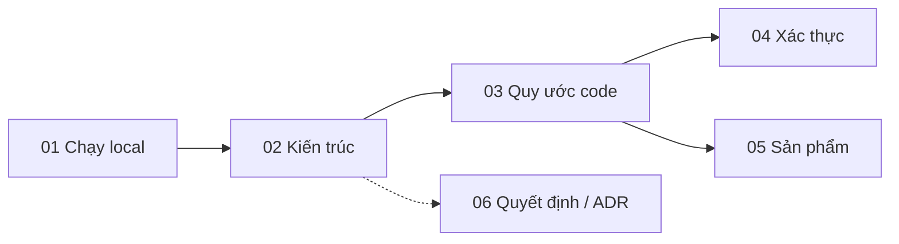

# Docs dự án TienThanh

Mục lục docs cho dev — người sửa code backend / frontend. Dev mới đọc theo thứ tự dưới đây.

| File | Đọc khi |
| --- | --- |
| [01-chay-local.md](01-chay-local.md) | Lần đầu cài và chạy dự án; bảng biến môi trường đầy đủ |
| [02-kien-truc.md](02-kien-truc.md) | Cần hiểu FE / BE / DB nối với nhau ra sao, muốn biết "sửa X ở đâu" |
| [03-quy-uoc-code.md](03-quy-uoc-code.md) | Trước khi thêm module / route / schema mới |
| [04-xac-thuc.md](04-xac-thuc.md) | Làm việc với đăng nhập, cookie, token, phân quyền |
| [05-san-pham.md](05-san-pham.md) | Làm việc với API sản phẩm |
| [06-quyet-dinh/](06-quyet-dinh/README.md) | Muốn biết vì sao chọn cấu trúc / công nghệ hiện tại |

Chưa có docs triển khai & vận hành: repo chưa có cấu hình triển khai (Dockerfile, CI, deploy) — kiểm tra 2026-11-01.
